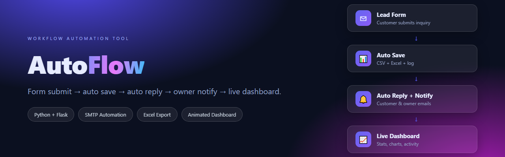
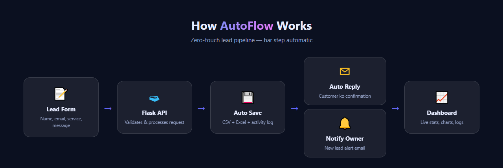
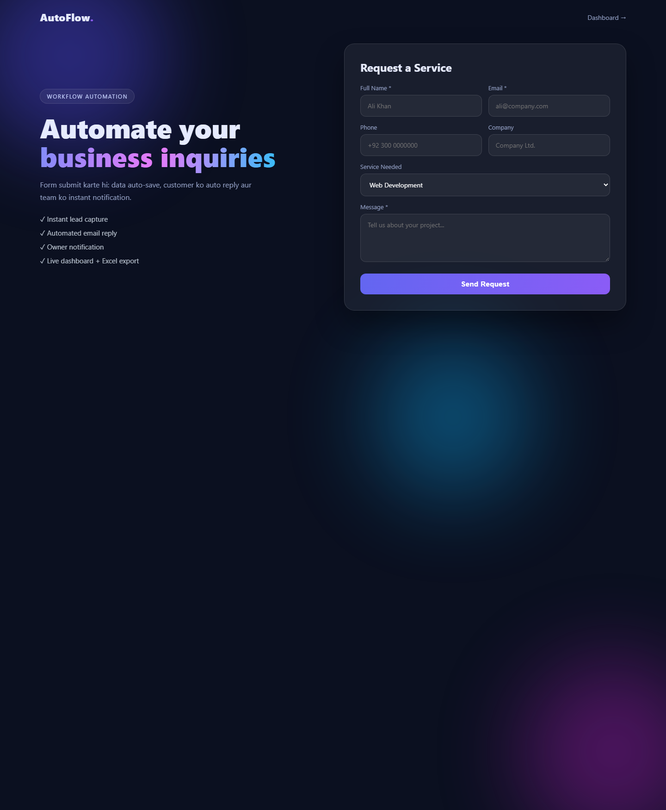
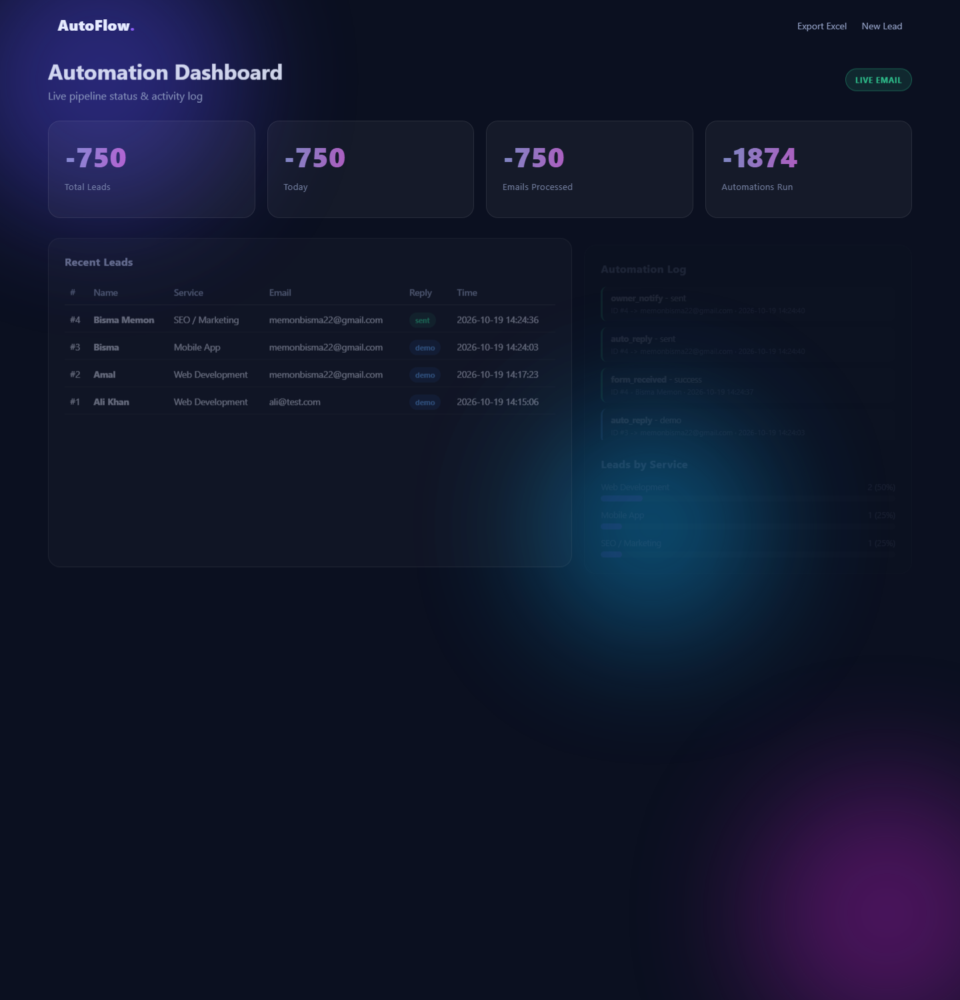

<p align="center">
  
</p>

<h1 align="center">AutoFlow</h1>

<p align="center">
  <b>Workflow Automation Tool</b> — Form submit hote hi: auto save, auto reply, owner alert aur live dashboard.
</p>

<p align="center">
  
  
  
  
  
  
</p>

<p align="center">
  <a href="#-features">Features</a> •
  <a href="#-how-it-works">How it works</a> •
  <a href="#-screenshots">Screenshots</a> •
  <a href="#-quick-start">Quick Start</a> •
  <a href="#-api-endpoints">API</a>
</p>

---

## 🚀 Overview

AutoFlow ek **zero-touch lead pipeline** hai — customer inquiry aati hai, aur aapki team bina kuch kiye:

- Customer ko **instant confirmation email**
- Owner ko **new lead alert**
- Sab data **CSV + Excel** me auto-save
- **Animated dashboard** par live stats

Manual data entry aur manual replies ka time khatam.

---

## ✨ Features

| Feature | Description |
|---|---|
| 📝 **Lead Capture Form** | Modern glassmorphism UI, fully responsive, animated |
| 💾 **Auto Save** | Har submission CSV + Excel (`.xlsx`) me automatic |
| ✉️ **Auto Reply** | Customer ko turant branded confirmation email (SMTP) |
| 🔔 **Owner Notification** | New lead details owner ke inbox me |
| 📊 **Live Dashboard** | Animated counters, service chart, activity log |
| 📥 **Excel Export** | One-click poora data download |
| 📜 **Activity Log** | Har automation ka timestamped history |
| 🧵 **Threaded Pipeline** | Emails background me — form turant respond karta hai |
| 🎭 **Demo Mode** | Bina SMTP credentials ke bhi pura pipeline test karein |

---

## ⚙️ How It Works

<p align="center">
  
</p>

1. **Lead Form** → customer details submit karta hai  
2. **Flask API** → validation + processing  
3. **Auto Save** → `data/submissions.csv` + `submissions.xlsx` + `logs.csv`  
4. **Parallel emails** → customer auto-reply + owner notification (SMTP)  
5. **Dashboard** → live stats, charts aur automation log  

---

## 📸 Screenshots

<table>
  <tr>
    <td width="50%">
      <b>Landing / Lead Form</b><br>
      
    </td>
    <td width="50%">
      <b>Automation Dashboard</b><br>
      
    </td>
  </tr>
</table>

---

## 🛠️ Quick Start

```bash
# 1. Clone
git clone https://github.com/khanzadigithubid/AutoFlow.git
cd AutoFlow

# 2. Install
pip install -r requirements.txt

# 3. Run
python app.py
```

| Page | URL |
|---|---|
| Lead Form | http://127.0.0.1:5000/ |
| Dashboard | http://127.0.0.1:5000/dashboard |
| Excel Export | http://127.0.0.1:5000/export |

---

## 📧 Live Email Setup (Optional)

Default me **demo mode** chalta hai (koi email nahi jata). Asli emails ke liye:

**Gmail:**
1. [myaccount.google.com](https://myaccount.google.com) → **Security** → **2-Step Verification** ON
2. **App passwords** → naya password banao ([direct link](https://myaccount.google.com/apppasswords))
3. Environment variables set karein:

```powershell
$env:SMTP_USER   = "aapka@gmail.com"
$env:SMTP_PASS   = "your-16-digit-app-password"
$env:OWNER_EMAIL = "owner@company.com"
python app.py
```

```bash
# Linux / macOS
export SMTP_USER="aapka@gmail.com"
export SMTP_PASS="your-16-digit-app-password"
export OWNER_EMAIL="owner@company.com"
python app.py
```

> ⚠️ **Security:** App password kabhi code me hardcode na karein aur repo me commit na karein. `.env` file `.gitignore` me hai.

---

## 🔌 API Endpoints

| Method | Endpoint | Description |
|---|---|---|
| `GET` | `/` | Lead capture form |
| `POST` | `/submit` | Form submit → pipeline trigger |
| `GET` | `/dashboard` | Animated live dashboard |
| `GET` | `/api/stats` | JSON stats (leads, emails, services) |
| `GET` | `/api/submissions` | All leads (JSON) |
| `GET` | `/api/logs` | Automation log (JSON) |
| `GET` | `/export` | Excel file download |

---

## 📁 Project Structure

```
AutoFlow/
├── app.py              # Flask routes + JSON API
├── automation.py       # Pipeline: save → reply → notify → log
├── config.py           # Settings (env variables)
├── requirements.txt
├── templates/
│   ├── index.html      # Lead capture form
│   ├── thanks.html     # Confirmation page (animated)
│   └── dashboard.html  # Live dashboard
├── static/
│   ├── style.css       # Glassmorphism + animations
│   └── script.js       # Counters, live refresh, charts
└── data/               # Auto-created (CSV + Excel) — git ignored
```

---

## 🗺️ Roadmap

- [ ] WhatsApp notification (Twilio)
- [ ] Admin login / auth
- [ ] Drag-drop automation rule builder
- [ ] MongoDB / PostgreSQL support
- [ ] Docker deployment

---

## 📄 License

MIT License — see [LICENSE](LICENSE) for details.

---

<p align="center">
  Made with ❤️ by <a href="https://github.com/khanzadigithubid">khanzadigithubid</a>
</p>
